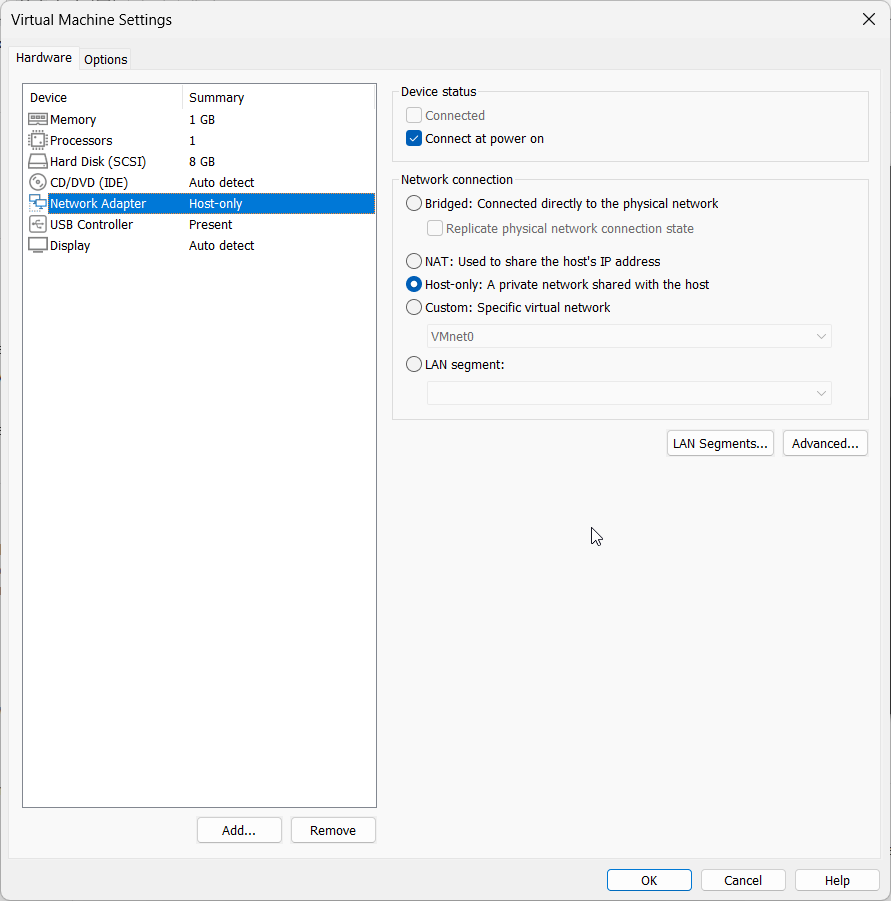

# Virtual Cybersecurity Lab Setup

**Status:** Initial setup completed

## 1. Project Overview

As part of my cybersecurity coursework, I set up an initial virtual lab using VMware, Kali Linux and Metasploitable2. I prepared Kali Linux as the testing machine and Metasploitable2 as the intentionally vulnerable target for future, authorised practice. My aim is to learn network security techniques in a lab environment rather than test systems outside its scope.

This project records the initial network configuration and the fresh-install snapshots for both virtual machines. Connectivity and external network isolation still need to be tested; the screenshots do not establish either result.



## 2. Objective

The objectives of this project were to:

- Set up Kali Linux and Metasploitable2 using VMware.
- Select Host-only networking for the virtual lab.
- Identify and document the IP addresses shown for both machines.
- Record the fresh-install snapshots as a baseline for future experiments.
- Prepare the lab for later network-scanning and vulnerability-assessment exercises.

## 3. Tools and Environment

| Component | Description |
| --- | --- |
| Hypervisor | VMware; exact product and version to be confirmed |
| Testing machine | Kali Linux |
| Target machine | Metasploitable2 |
| Network mode | Host-only, as shown in VMware settings |
| Network subnet | `192.168.247.0/24` |
| Kali Linux IP address | `192.168.247.128/24` |
| Metasploitable2 IP address | `192.168.247.129/24` |
| Snapshots | Fresh-install snapshot shown for each virtual machine |

## 4. Network Configuration

The VMware network adapter settings show Host-only mode selected. VMware describes this option as a private virtual network shared with the host. This setting alone does not confirm the lab's external isolation, which remains to be verified.

The addresses shown for both virtual machines fall within the `192.168.247.0/24` subnet:

```text
Kali Linux (192.168.247.128/24)
        |
VMware Host-only network (192.168.247.0/24)
        |
Metasploitable2 (192.168.247.129/24)
```

This diagram represents the configured network and addresses; it does not demonstrate successful communication between the machines.

## 5. Methodology

**Step 1: Virtual machine preparation**

I prepared two virtual machines in VMware: Kali Linux for security testing and Metasploitable2 as the intentionally vulnerable practice target.

**Step 2: Network configuration**

I selected Host-only networking in the VMware network adapter settings.

**Step 3: IP address inspection**

I used the following commands to inspect the network interfaces:

- On Kali Linux: `ip a`
- On Metasploitable2: `ifconfig`

The screenshots show Kali Linux with `192.168.247.128/24` and Metasploitable2 with `192.168.247.129/24`.

**Step 4: Snapshot review**

I checked VMware Snapshot Manager and recorded the fresh-install snapshot shown for each virtual machine. These provide a documented baseline for future experiments.

**Step 5: Evidence collection**

I captured seven screenshots of the virtual machines, network settings and snapshot information. The gallery captions describe what each screenshot shows.

## 6. Results and Evidence

The initial configuration is documented in seven screenshots:

| Evidence | File | What it shows |
| --- | --- | --- |
| VMware network settings | `vmware-host-only-settings.png` | The network adapter is set to Host-only. |
| Kali Linux desktop | `kali-virtual-machine.png` | The Kali Linux virtual machine in VMware. |
| Kali Linux network configuration | `kali-network-configuration.png` | The `192.168.247.128/24` IPv4 address. |
| Metasploitable2 network configuration | `metasploitable-network-configuration.png` | The `192.168.247.129/24` IPv4 address. |
| Initial Metasploitable2 network state | `metasploitable-initial-network.png` | An earlier interface view in which an IPv4 address is not displayed. |
| Kali Linux snapshot | `kali-snapshot.png` | The fresh-install snapshot shown in Snapshot Manager. |
| Metasploitable2 snapshot | `metasploitable-snapshot.png` | The fresh-install snapshot shown in Snapshot Manager. |

The screenshots document the initial configuration. They do not verify connectivity between the virtual machines or external network isolation. I have not recorded scan results or vulnerability-assessment findings.

[View the Lab Evidence Gallery](evidence/)

## 7. Challenges and Troubleshooting

One screenshot shows Metasploitable2 without an IPv4 address displayed, while a later screenshot shows `192.168.247.129/24`. The available evidence does not establish why the displays differ, so I have not described a cause or a troubleshooting resolution.

I have not yet recorded the results of connectivity or external-isolation checks. I will add any troubleshooting details after carrying out those checks and observing an issue.

## 8. Reflection and Future Improvements

This project helped me understand the importance of preparing and documenting a lab before carrying out security exercises. I practised working with virtual machines, inspecting network interfaces and recording configuration evidence.

I also learned that selecting Host-only networking does not, by itself, prove that a lab is completely isolated. I need to verify the network behaviour before using the environment for testing.

Next, I plan to test connectivity between Kali Linux and Metasploitable2, verify external network isolation and record the results. After that, I intend to use the lab for authorised Nmap scanning and vulnerability-assessment exercises, documenting their scope, methods and evidence separately.
